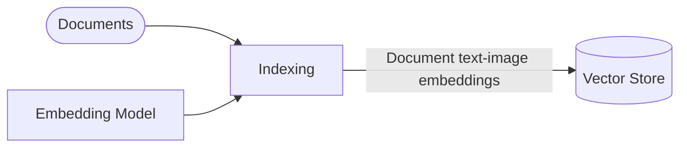
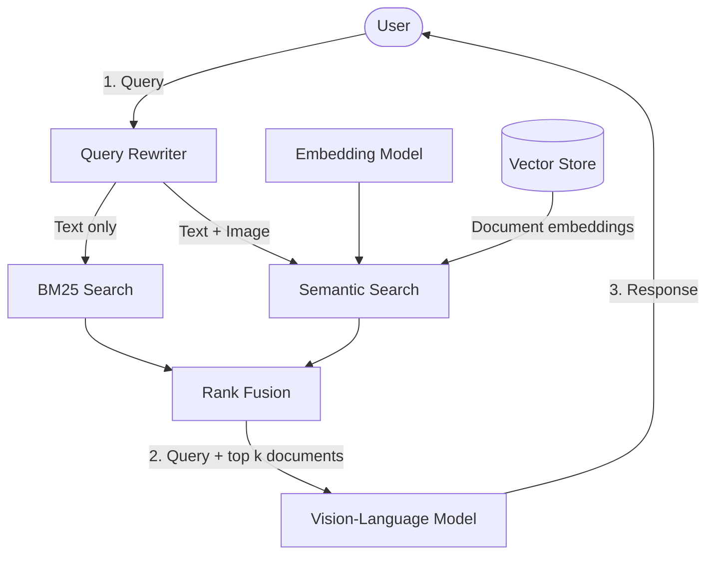

# 👁️📑 Multimodal RAG over Pokémon documents with Nemotron Embed VL

This multimodal (vision & language) RAG (Retrieval-augmented generation) pipeline can use text and images to retrieve relevant chunks of information from a knowledge base. Those chunks are then used to augment the input to a VLM (vision-language model) that in conclusion can generate a context-aware response.

In this demo project a toy dataset is being used. However, a system like this could easily be used with business documents, technical manuals, etc. and solve real-world problems.

- **Dataset:** [cian-ps/pokedb-vl-1k](https://huggingface.co/datasets/cian-ps/pokedb-vl-1k)
- **Embedding model:** [nvidia/llama-nemotron-embed-vl-1b-v2](https://huggingface.co/nvidia/llama-nemotron-embed-vl-1b-v2)
- **Vision-language model:** [Qwen/Qwen3-VL-2B-Instruct](https://huggingface.co/Qwen/Qwen3-VL-2B-Instruct)
- **🤗 Spaces Demo:** [cian-ps/nemotron-vl-rag-pipeline-pokemon](https://huggingface.co/spaces/cian-ps/nemotron-vl-rag-pipeline-pokemon)

## Architecture

Definitions:
- **query**: user input in form of text, or text + an image, used for comparison to the documents as well as prompting the VLM
- **document**: a document-like image + text pair holding one chunk of information. In this case, it's one row from the dataset, containing an image and markdown text both generated from a single page pdf document, holding information about one Pokémon.
- **knowledge base**: the dataset
- **vector store**: in this case, it's simply one tensor of embedding vectors for all samples of the dataset

At indexing time, documents from the knowledge base are encoded using an embedding model, which creates vector representations of the input. Those embeddings are then stored for later use.

At runtime, the user can query the system with text, or text plus an image. The pipeline first rewrites the query into several alternative formulations, then retrieves documents with a hybrid of semantic (vector) and lexical (keyword) search. Those ranked lists are merged with reciprocal rank fusion into a single top-k set of documents, which is passed to the VLM together with the query to produce a context-aware response.

**Query rewriting.** Unclear or conversational user questions can miss relevant documents if encoded as-is. The VLM therefore rephrases the original query into three variations: one that cleans up the same meaning, one that asks a useful subquestion, and one that generalizes toward the underlying principle. Encoding and searching with these diversified views of the same question increases the chance that vector search surfaces useful candidates.

**Hybrid retrieval.** Semantic search embeds the rewritten queries (and optional query image) with the same embedding model used at indexing time, then ranks documents by cosine similarity against the vector store. Additionally, a BM25 keyword search runs over the document text with the primary rewritten query. Lexical search can surface exact matches—names, numbers, rare terms—that dense embeddings alone might underrank or miss. Combining both is hybrid retrieval.

**Reciprocal rank fusion (RRF).** Each search path produces its own ranking. RRF merges them without needing calibrated raw scores: a document scores highly if it appears near the top of one or more lists. For document $d$ over rankings $(r_1, \ldots, r_n)$:

$$
RRF(d) = \sum_{i=1}^{n} \frac{1}{k + rank_i(d)}
$$

where $rank_i(d)$ is the 1-based position of $d$ in ranking $i$, and $k$ is a smoothing constant (here $k = 60$, a common default). The fused scores are sorted descending to yield the final retrieval order.

## Dataset

The dataset contains images and text from pdf documents about different Pokémon species. This data was generated using the information from [PokeDB](https://pokedb.org/).

More information at: [cian-ps/pokedb-vl-1k](https://huggingface.co/datasets/cian-ps/pokedb-vl-1k)

## Nvidia's LLAMA Nemotron Embed VL 1B V2

This embedding model uses a shared embedding space for text and images. It can encode text and images at the same time, as well as only text or only images. The model specifically supports document-like images (containing text, tables, charts, and infographics) with accompanying text (captions, descriptions, OCR text) to create semantically meaningful embeddings.

More information at: [nvidia/llama-nemotron-embed-vl-1b-v2](https://huggingface.co/nvidia/llama-nemotron-embed-vl-1b-v2)

## Qwen3 VL 2B Instruct

This vision-language model is used for the generative aspects in the pipeline. As the name suggests, it can handle vision and language inputs and is only 2 billion parameters in size.

More information at: [Qwen/Qwen3-VL-2B-Instruct](https://huggingface.co/Qwen/Qwen3-VL-2B-Instruct)
