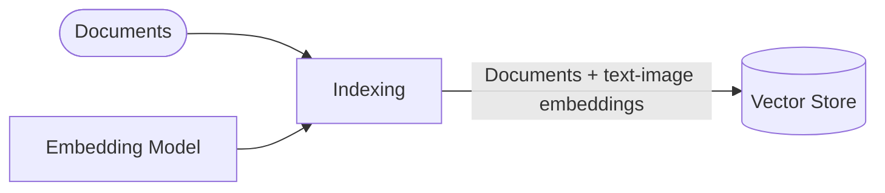
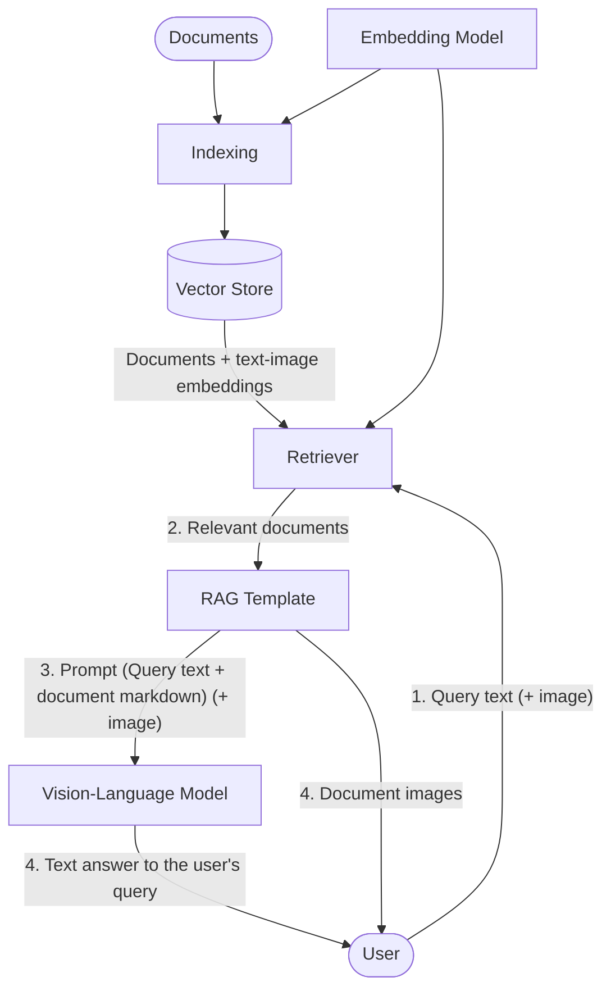

# 👁️📑 Multimodal RAG over Pokémon documents with Nemotron Embed VL

This multimodal (vision & language) RAG (Retrieval-augmented generation) pipeline can use text and images to retrieve relevant chunks of information from a knowledge base. Those chunks are then used to augment the input to a VLM (vision-language model) that in conclusion can generate a very context-aware response.

In this demo project a toy dataset is being used. However, a system like this could easily be used with business documents, technical manuals, etc. and solve real-world problems.

- **Dataset:** [cian-ps/pokedb-vl-1k](https://huggingface.co/datasets/cian-ps/pokedb-vl-1k)
- **Embedding model:** [nvidia/llama-nemotron-embed-vl-1b-v2](https://huggingface.co/nvidia/llama-nemotron-embed-vl-1b-v2)
- **Vision-language model:** [Qwen/Qwen3-VL-2B-Instruct](https://huggingface.co/Qwen/Qwen3-VL-2B-Instruct)
- **🤗 Spaces Demo:** [cian-ps/nemotron-vl-rag-pipeline-pokemon](https://huggingface.co/spaces/cian-ps/nemotron-vl-rag-pipeline-pokemon)

## Architecture

Definitions:
- query: user input in form of text, or text + an image, used for comparison to the documents as well as prompting the VLM
- document: a document-like image + text pair holding one chunk of information. In this case, it's one row from the dataset, containing an image and markdown text both generated from a single page pdf document, holding information about one Pokémon.
- knowledge base: the dataset
- vector store: in this case, it's the dataset paired with a tensor that holds embedding vectors for each row of the dataset

At indexing time, documents from the knowledge base are encoded using an embedding model, which creates vector representations of the input. Those embeddings are then stored for later use.

At runtime, the user can query the system with a text or image. The query is encoded using the same embedding model and then compared to the embeddings in the vector store to retrieve the most relevant documents. The document markdown augments the prompt to the VLM. In the demo, the retrieved document images are also returned to the user. This step is optional and gives the user the chance to see which information the VLM gets.

## Dataset

The dataset contains images and text from pdf documents about different Pokémon species. This data was generated using the information from [PokeDB](https://pokedb.org/).

More information at: [cian-ps/pokedb-vl-1k](https://huggingface.co/datasets/cian-ps/pokedb-vl-1k)

## Nvidia's LLAMA Nemotron Embed VL 1B V2

This embedding model uses a shared embedding space for text and images. It can encode text and images at the same time, as well as only text or only images. The model specifically supports document-like images (containing text, tables, charts, and infographics) with accompanying text (captions, descriptions, OCR text) to create semantically meaningful embeddings.

More information at: [nvidia/llama-nemotron-embed-vl-1b-v2](https://huggingface.co/nvidia/llama-nemotron-embed-vl-1b-v2)

## Qwen3 VL 2B Instruct

This vision-language model is good balance between size and performance. With 2 billion parameters, it's on the smaller side, but still very capable of handling complex tasks.

More information at: [Qwen/Qwen3-VL-2B-Instruct](https://huggingface.co/Qwen/Qwen3-VL-2B-Instruct)
